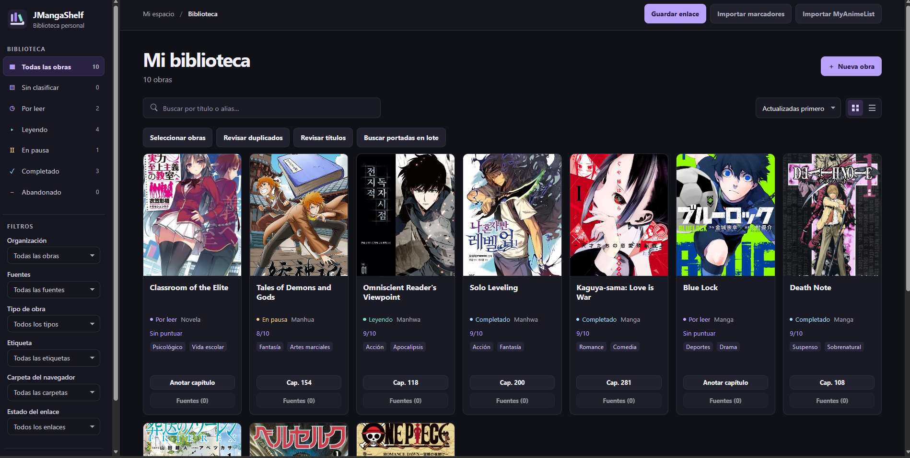

# JMangaShelf 1.0.0

Biblioteca personal de manga para Windows. Guarda obras, fuentes, capítulos, puntuaciones y portadas en tu equipo. La interfaz en español se abre en tu navegador. Puedes buscar por título o alias, filtrar por carpeta, revisar posibles duplicados y continuar una lectura con un clic.

JMangaShelf es un proyecto personal independiente, gratuito, no comercial y de código abierto, sin garantía de soporte continuo. Organiza manga, manhwa, manhua, novelas y marcadores del navegador en una biblioteca local.

## Biblioteca



Biblioteca de demostración. Los estados, capítulos, etiquetas y puntuaciones son ilustrativos. Las portadas mostradas proceden de AniList y pertenecen a sus respectivos titulares. La licencia MIT cubre el código y los recursos originales de JMangaShelf. [Licencias y atribuciones](TERCEROS.md)

## Abrir la edición portable

Descarga el ZIP de Windows x64 desde [JMangaShelf v1.0.0](https://github.com/JeisonOJ/JMangaShelf/releases/tag/v1.0.0). El ejecutable se distribuye sin firma Authenticode.

1. Extrae **todo** el ZIP de Windows x64 en una carpeta local donde puedas escribir, por ejemplo dentro de Documentos.
2. Haz doble clic en **JMangaShelf.exe**. El navegador predeterminado abre la biblioteca en [127.0.0.1:8766](http://127.0.0.1:8766/). Un segundo doble clic vuelve a abrir la misma biblioteca. Puedes crear un acceso directo de Windows al ejecutable para conservar su icono.
3. Para terminar, pulsa **Cerrar JMangaShelf** en el menú lateral y confirma. Si cerraste solo la pestaña, vuelve a abrir el ejecutable para recuperar el control. Los fallos de arranque muestran un aviso y el registro de diagnóstico se guarda, cuando corresponde, en `JMangaShelf-datos/aplicacion.log`.

El ZIP incluye Python y las dependencias. Al abrirse por primera vez crea la carpeta **JMangaShelf-datos** junto al ejecutable. Contiene `library.sqlite3`, sus archivos auxiliares, las portadas en caché, los registros y las copias automáticas. Mantén la carpeta completa en una ubicación privada. La biblioteca empieza vacía.

## Actualizar o adoptar una biblioteca

1. Si puedes abrir la versión de origen, exporta una copia desde **Copias de seguridad**. Ciérrala y guarda además una copia independiente de **toda** su carpeta de datos, incluidos los archivos auxiliares de SQLite. En la edición de desarrollo esa carpeta se llama `data`.
2. Para actualizar el portable, extrae la nueva versión en **otra carpeta vacía**. Antes del primer arranque, copia allí la carpeta `JMangaShelf-datos` respaldada, junto al nuevo ejecutable. Conserva la versión anterior hasta verificar la nueva.
3. Para adoptar la biblioteca de desarrollo, inicia el portable vacío y restaura el JSON mediante la opción de añadir obras. Para una copia completa o si superas el límite JSON, copia el contenido del respaldo de `data` en una carpeta nueva llamada `JMangaShelf-datos` junto al portable **antes de abrirlo**. Trabaja sobre copias con ambas aplicaciones cerradas. Las versiones antiguas compatibles se actualizan en la copia con un respaldo SQLite verificado.
4. Comprueba el número de obras, una puntuación, un capítulo y una portada local. Si algo falla, cierra la copia nueva y conserva el respaldo original para volver a la versión anterior.

## Importar marcadores del navegador

Exporta los favoritos como HTML desde el administrador de marcadores de Edge o Chrome, o desde **Biblioteca → Importar y respaldar → Exportar marcadores a HTML** en Firefox. En JMangaShelf elige **Importar marcadores → Ver vista previa**, revisa las carpetas y confirma la selección. Las pruebas cubren ejemplos sintéticos de los tres dialectos. Otros navegadores que exporten la estructura Netscape DL/H3/A pueden funcionar. Los respaldos JSON de Firefox, los perfiles internos, los iconos y las etiquetas propias del navegador quedan fuera del formato admitido.

JMangaShelf conserva las rutas originales seleccionadas. Si una URL ya pertenece a una obra, se añaden las rutas que falten. Los títulos parecidos se señalan durante la vista previa y las obras se importan por separado.

## Importar desde MyAnimeList

Descarga tu exportación de manga desde el panel de MyAnimeList e impórtala desde **Importar MyAnimeList**. La vista previa admite XML UTF-8 y XML.GZ de hasta 16 MB, también después de descomprimir, con un máximo de 10 000 entradas.

- El importador lee el ID, el título, la puntuación, el estado y los capítulos leídos. Las fechas disponibles aparecen en la vista previa. El formato validado trae un título principal por entrada. Las fechas de lectura no se guardan como fechas de creación o edición de JMangaShelf.
- Las coincidencias por ID usan asociaciones guardadas o enlaces de catálogo presentes en la biblioteca. Las coincidencias por título o alias necesitan que elijas la ficha. En la vista previa puedes vincular, crear cuando corresponda u omitir. Las fichas nuevas quedan sin clasificar.
- MAL usa cero para indicar ausencia de puntuación. JMangaShelf admite un cero intencionado. La vista previa prefiere los valores locales cuando ya hay puntuación y permite elegir el valor de MAL por campo. Conserva los títulos, las fuentes y los demás datos locales. Repetir una importación usa los ID guardados.

[Panel de exportación de MyAnimeList](https://myanimelist.net/panel.php?go=export)

## Organizar la biblioteca

Las importaciones y las capturas nuevas entran en **Sin clasificar**. Puedes asociar una captura a una obra existente. En el editor, elige la fuente preferida y distingue referencias de enlaces de lectura.

El editor admite un título alternativo por línea. La búsqueda incluye estos alias. Cada fuente tiene su propio estado manual de enlace. Usa el filtro **Estado del enlace** para encontrar obras con fuentes rotas o sospechosas.

El filtro **Carpeta del navegador** incluye sus subcarpetas. **Seleccionar resultados** selecciona todas las coincidencias, incluso las que aún no se muestran. En **Organizar selección** puedes cambiar tipo, etiquetas, clasificación o estado. **Sugerir tipo por carpetas del navegador** usa nombres completos de carpetas y muestra una vista previa de las obras que cambiarán. **Revisar títulos** permite comprobar y aplicar títulos y capítulos sugeridos.

En **Revisar duplicados**, abre un grupo para ver títulos, URL y carpetas originales del navegador que respaldan la sugerencia. Las pistas de carpeta se basan en la ruta completa, el nombre de la carpeta y los marcadores guardados directamente en ella. Los formatos de edición inciertos y los posibles enlaces de catálogo se señalan para revisión.

Usa **Quitar de esta comparación** o **Añadir otra obra** para ajustar la selección. **No son la misma obra** descarta la sugerencia. Puedes reconsiderarla desde **Sugerencias descartadas**. Con **Revisar y fusionar**, elige la obra principal, el título, el progreso, el estado, la fuente preferida y la portada. La vista previa muestra los enlaces y los datos que se conservarán. Las demás portadas quedan disponibles en el editor.

En **Seleccionar obras → Eliminar seleccionadas**, revisa la lista de fichas y escribe **ELIMINAR** para confirmar. La operación elimina de JMangaShelf los datos asociados a esas fichas. Las importaciones de MAL y las eliminaciones en lote guardan primero una copia SQLite verificada en la subcarpeta `backups` de los datos.

El editor permite puntuar de 0 a 10 o dejar la obra sin puntuar. **Mayor puntuación** ordena las obras puntuadas primero. Los respaldos JSON v4 guardan las puntuaciones y los ID de MyAnimeList. La restauración admite respaldos v1 a v4. La migración también genera una copia SQLite verificada en la subcarpeta `backups` de los datos.

## Portadas y copias

- Usa **Buscar portada** en el editor para consultar el catálogo manga de AniList con el título actual. Puedes cambiar la consulta y comparar portadas, títulos, formatos y países. Elige **Usar esta portada** y luego **Guardar obra**. También puedes conservar la portada actual, subir un archivo o usar una URL.
- **Buscar portadas en lote** trabaja con fichas sin portada. Puedes empezar por los resultados filtrados o por toda la biblioteca. Cada consulta se inicia de forma manual y muestra hasta ocho resultados. Puedes buscar con otro título, rechazar la propuesta, omitir la ficha o pausar el bloque. La sesión queda en memoria hasta que termines o recargues la página.
- Las portadas de AniList confirmadas se validan y se reutilizan desde la subcarpeta `anilist-covers` de los datos. La aplicación guarda una copia de cada portada asignada en SQLite. Las copias JSON incluyen las imágenes asignadas. La caché de descargas puede reconstruirse al volver a consultar AniList.
- Las imágenes locales se guardan en la base de datos. Las portadas animadas usan su primer fotograma. Una portada por URL se pide desde el navegador al pulsar **Mostrar portada**. Al abrir una lectura también se usa el navegador y el sitio de destino puede requerir conexión.
- La opción **Copias de seguridad** exporta la biblioteca completa a JSON, incluidas las imágenes locales. La restauración añade obras nuevas de forma predeterminada. Si coincide un ID de ficha, un ID de MyAnimeList o un enlace, se omite esa obra de la copia. **Reemplazar toda la biblioteca** exige escribir `REEMPLAZAR`.
- Los archivos HTML admiten hasta 16 MB y 20 000 marcadores. La restauración JSON admite solicitudes de hasta 128 MB. Para bibliotecas mayores, sigue el procedimiento de copia completa indicado arriba.

## Lectura diaria

**Continuar lectura** abre la fuente preferida de una obra en curso. **Fuentes y referencias** muestra también los enlaces alternativos con su estado manual. Pulsa el capítulo de la tarjeta para editarlo y guardarlo sin abrir la ficha completa.

Al acercarte al final se añaden hasta 72 tarjetas más. La edición conserva la posición y las tandas cargadas. También puedes usar **Cargar más obras** con el teclado.

## Privacidad y capturas

La integración opcional con AniList permite identificar obras y buscar portadas bajo demanda. Las imágenes elegidas se guardan localmente para cada usuario. JMangaShelf es independiente y carece de afiliación, respaldo o aprobación expresa de AniList. Su finalidad es organizar una colección personal. El proyecto no sincroniza listas con AniList, ni busca replicar o redistribuir su catálogo. La descarga del programa no incorpora una colección de portadas. Los metadatos y el arte de terceros conservan sus respectivos derechos. La integración está sujeta a las condiciones de la API y puede cambiar o dejar de estar disponible. [AniList](https://anilist.co/) · [Condiciones de la API](https://docs.anilist.co/guide/terms-of-use)

La biblioteca funciona en el equipo. Buscar en AniList envía el título consultado a su API. Las miniaturas, las portadas externas y los enlaces de lectura contactan sus respectivos destinos. Los respaldos pueden contener notas, direcciones de lectura e imágenes privadas. Para capturas públicas, usa una copia vacía con títulos inventados y portadas propias, sin nombres de usuario, rutas locales ni marcadores personales.

## Ejecutar desde las fuentes

Con Python 3.14 x64 instalado, **Abrir-JMangaShelf.cmd** prepara el entorno y abre el navegador en el puerto 8765. **Iniciar-JMangaShelf.cmd** permite abrir la dirección manualmente. Detén esta edición con Ctrl+C en la consola. El ZIP de fuentes descarga las dependencias durante la primera instalación. Consulta [las instrucciones de compilación y publicación](RELEASE.md) y [las licencias y condiciones de los servicios](TERCEROS.md).

Para usar la versión de desarrollo desde la barra de tareas, ejecuta `pwsh -File tools/Install-DevelopmentShortcut.ps1` con el entorno `.venv` ya preparado. Esto crea **JMangaShelf Desarrollo** en el Escritorio. Haz clic derecho en el acceso y elige **Mostrar más opciones → Anclar a la barra de tareas**. Si la opción falta, usa el mismo menú en `JMangaShelf-Desarrollo.exe`, en la raíz del proyecto.

El acceso utiliza el entorno y la biblioteca local del proyecto en el puerto 8765. Usa **Cerrar JMangaShelf** en el menú lateral y vuelve a abrir el acceso para cargar cambios en el código. Si reutilizaste un servidor arrancado desde la consola, ciérralo con Ctrl+C. El registro del iniciador gráfico está en `build/desarrollo.log`.

## Pruebas

```powershell
.\.venv\Scripts\python.exe -m unittest discover -s tests -v
```
